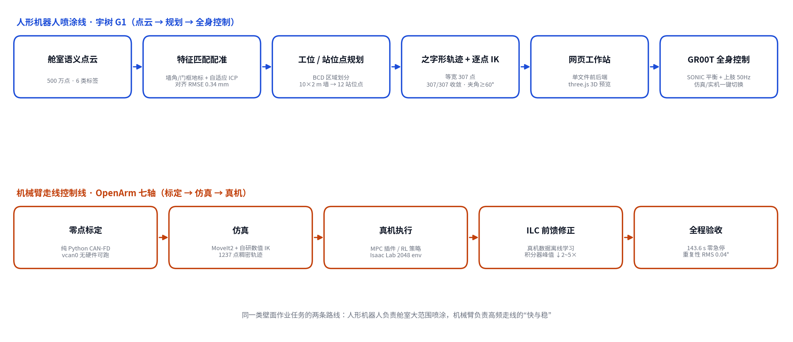
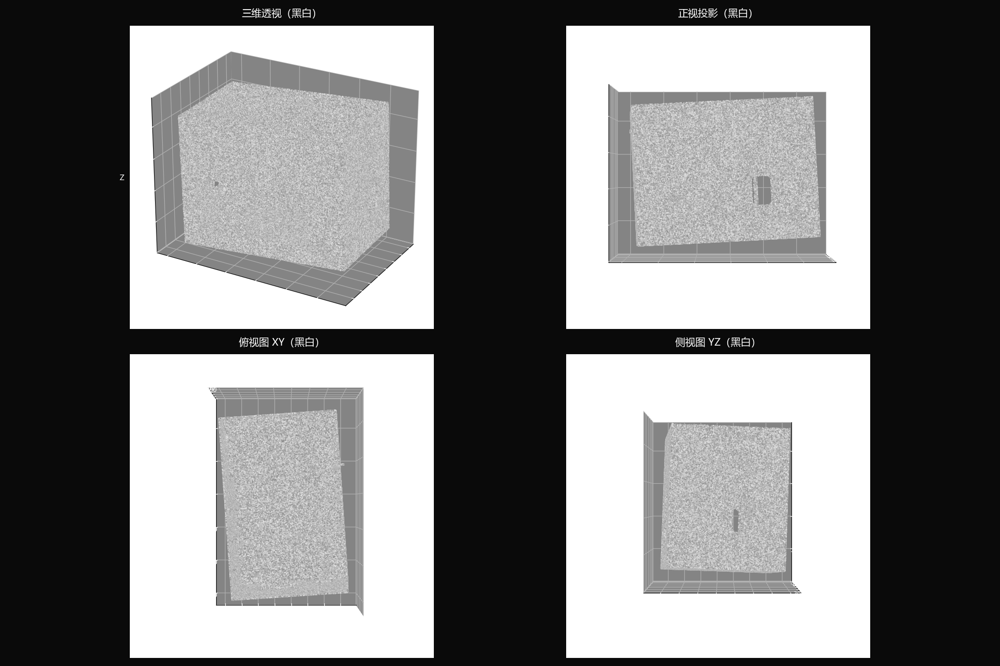
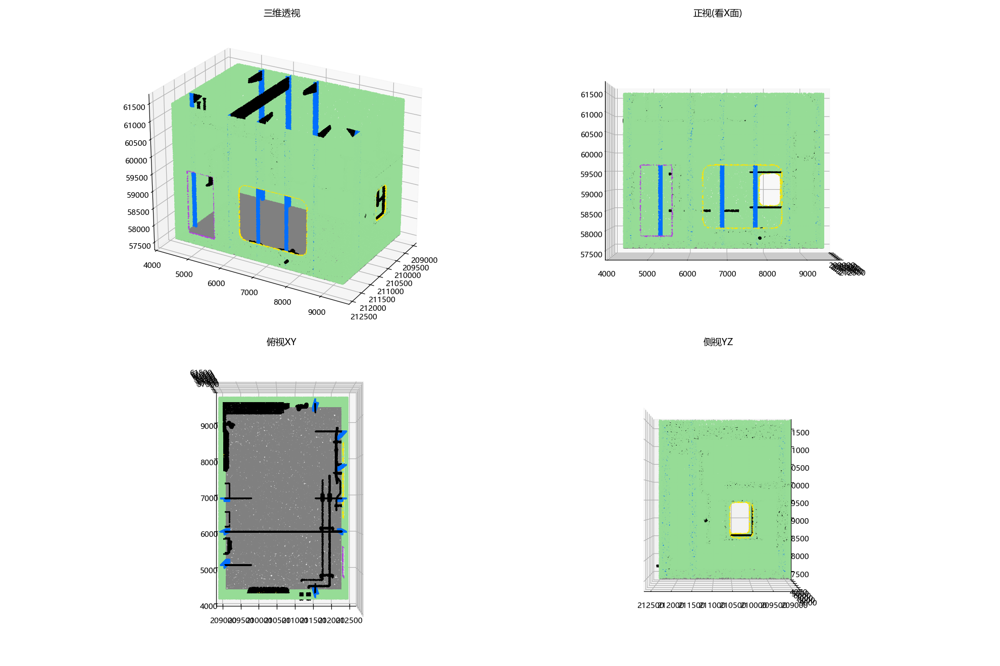
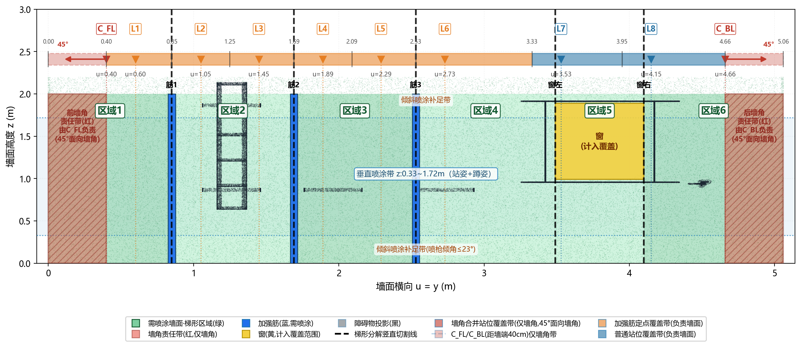
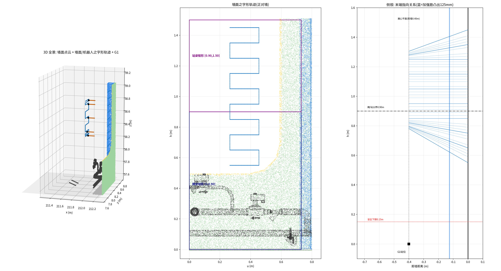
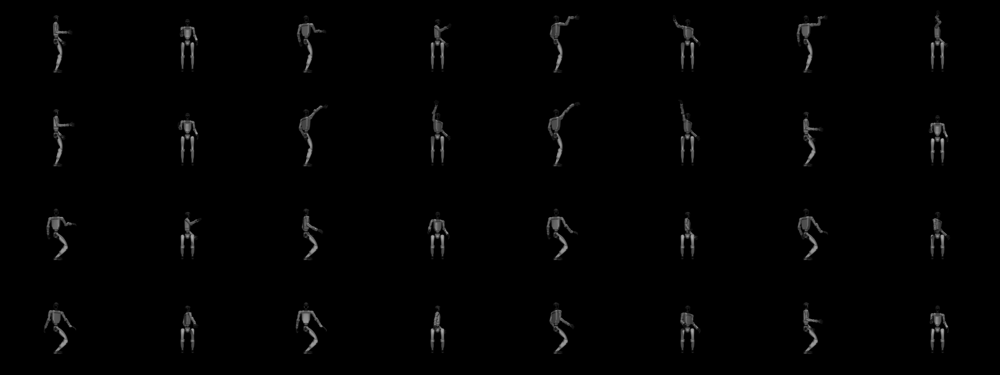
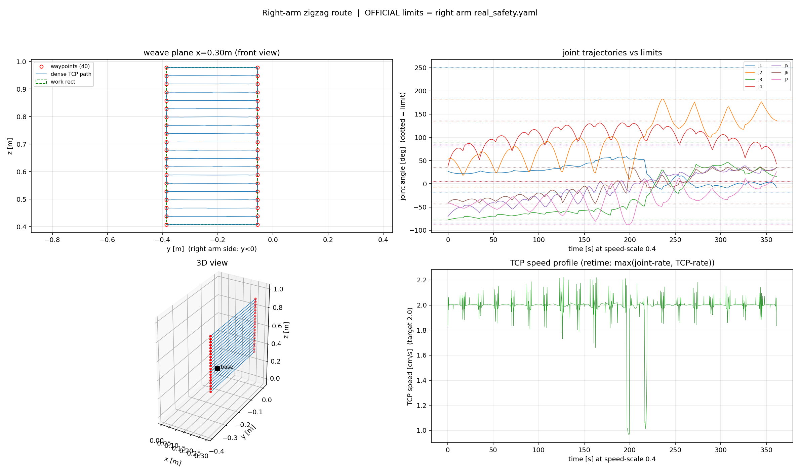

<div align="center">

# Scan · Plan · Spray

**From point cloud to real-robot spraying: a full-stack lab for wall operations on robots**


[简体中文](README.md) | **English**

</div>



## What this is

Two complete technical tracks for the same task — **automatic line-tracing / spraying on walls**:

- **Humanoid track (Unitree G1)**: cabin point-cloud registration → spray station & stance planning → constant-width zigzag trajectories with per-point IK → a web workstation → whole-body control execution, with the control policy based on NVIDIA **GEAR-SONIC** and one-switch sim/real modes.
- **Robot-arm track (OpenArm v1, 7-DOF)**: zero calibration → simulation → real robot, pushed through three layers (MPC / reinforcement learning / ILC), cutting one 36-waypoint run from ~300 s down to **143.6 s** with zero e-stops.

The four modules are independent and each runs on its own. `g1-wall-spray` consumes exactly the output of `pointcloud-registration`, and its workspace computation inherits the method from `station-planning`.

This repository is an archival record of that work: every module keeps its runnable code, measured results and design documents.

## Modules

| Module | What it does | Entry point |
|---|---|---|
| [pointcloud-registration](pointcloud-registration/) | Register a grayscale robot scan against a semantic reference map + **label transfer**, hand-written in pure numpy | `python register_and_label.py` |
| [station-planning](station-planning/) | **Spray cell decomposition (BCD) and stance planning** on Monte-Carlo reachability | `station_planning.m` (MATLAB) |
| [g1-wall-spray](g1-wall-spray/) | G1 wall-spraying **web workstation + whole-body control** (policy based on GEAR-SONIC) | `./启动工作站.sh` → `127.0.0.1:8090` |
| [openarm-zigzag](openarm-zigzag/) | OpenArm 7-DOF **calibration → simulation → real robot**, with MPC/RL/ILC | see the module [README](openarm-zigzag/README.en.md) |

## Results at a glance

| Module | Metric | Value |
|---|---|---|
| pointcloud-registration | Alignment RMSE (full-size data) | **≈ 0.34 mm** |
| | Dependencies | numpy + matplotlib only — no PCL/Open3D |
| station-planning | 10 m × 2 m demo wall | 4 BCD cells → **12 stances**, gapless coverage |
| | Per-stance coverage (±30° waist yaw) | ≈1.1 m wide; reachability 1.12 m² / spray coverage 2.53 m² |
| g1-wall-spray | Per-point IK on the zigzag | **307/307 converged**, gun-wall angle ≥60° throughout |
| | NN-IK seed convergence (iters=60) | **98.0%** vs 31.3% with random seeds |
| | Base-disturbance compensation (wrist error, world frame) | 32 mm → **4 mm** |
| | Full planning pipeline (03 → packaging → final audit) | ≈ 33 s |
| openarm-zigzag | Full-run duration (MPC baseline → RL+ILC) | ~300 s → **143.6 s**, zero e-stops |
| | Tracking / run-to-run repeatability | mean 1.19° / RMS **0.04°** |
| | Low-frequency sway suppression (0.5–2 Hz) | 3.8° → 0.7°; integrator peak down 2–5× |

## Repository layout

```
scan-plan-spray/
├── pointcloud-registration/   # point-cloud registration + semantic transfer (pure numpy)
│   ├── register_and_label.py  #   main algorithm (806 lines, full method notes in the header)
│   ├── make_sample_data.py    #   builds the downsampled sample (sample data is bundled)
│   ├── 舱室点云/                #   sample input ply files + ground-truth transform
│   ├── docs/                  #   algorithm design document (docx, in Chinese)
│   └── figures/
├── station-planning/          # spray cell & stance planning (BCD)
│   ├── station_planning.m     #   MATLAB entry: full 10×2 m demo
│   ├── workspace/             #   Python reachability (Tiangong 3.0 FK Monte-Carlo)
│   ├── docs/                  #   design doc V2.0 (PDF) + original plan (MD)
│   └── figures/
├── g1-wall-spray/             # G1 wall-spraying workstation (web + WBC)
│   ├── scripts/               #   numbered pipeline 00–13 + exec/ (daemon/streaming/estop)
│   ├── station/               #   config, NN-IK models, three.js frontend assets
│   ├── media/                 #   result figures + MuJoCo replay video
│   └── README.md              #   module deep-dive (incl. sim/real switch)
├── openarm-zigzag/            # OpenArm 7-DOF experiment platform
│   ├── 标定/ 仿真/ real/ ilc_sim/   # calibration / simulation / real robot / ILC sim
│   ├── docs/                  #   9 technical documents (architecture/PD/RL/MPC/ILC)
│   ├── assets/figures/
│   └── README.md / README.en.md
└── assets/                    # overview figure for this README + its script
```

## Quick start

**pointcloud-registration** (numpy + matplotlib only; sample data bundled)

```bash
cd pointcloud-registration
python register_and_label.py     # coarse → adaptive ICP → label transfer → ply + 4-view png
```

The full 5-million-point clouds are too large to ship; regenerate the downsampled sample with `make_sample_data.py --src <path-to-original-project>`.

**station-planning**

```matlab
run('station_planning.m')   % BCD decomposition + 12 stances + plots for the 10×2 m wall
```

A pure-Python reachability version is provided at `workspace/ws_calc.py` (Tiangong 3.0 right-arm FK Monte-Carlo + alpha-shape boundary).

**g1-wall-spray** (first clone [GR00T-WholeBodyControl](https://github.com/NVlabs/GR00T-WholeBodyControl) **next to this repo** and set up the conda envs; see the module README)

```bash
cd g1-wall-spray
./启动工作站.sh          # open http://127.0.0.1:8090
# Web flow: pick robot/stance/row spacing → ① plan trajectory → ② confirm motion → ③ export package
# Sim/real switch: robot_mode in station/env.json ("sim" / "real")
```

**openarm-zigzag** (Ubuntu 24.04 + ROS 2 Jazzy; the calibration tool runs hardware-free on vcan0)

```bash
cd openarm-zigzag
cat README.en.md          # five-step quick start: calibrate → MoveIt2 sim → MPC on real → RL → ILC
```

## Module highlights

### pointcloud-registration — registration without calling a library

Given a grayscale robot scan and a hand-held semantic map, everything from the k-d tree to ICP is hand-written numpy. Coarse registration skips generic feature matching and exploits the fact that a cabin is a rectangular room: **four wall corners + the offset door frame act as structural landmarks**, matched by distance-geometry consistency on triplets, solved with Kabsch, and disambiguated by dense overlap scoring. Fine registration is an **adaptive-threshold point-to-plane ICP** (ε = μ + 0.1σ rejection + Lie-algebra updates + dual convergence criteria). Semantic labels are then transferred through a voxel-hash nearest-neighbor pass.

<table>
<tr><td width="50%"></td>
<td width="50%"></td></tr>
<tr><td align="center">Input: grayscale robot scan (local frame)</td>
<td align="center">Output: registered back + transferred semantic labels</td></tr>
</table>

### station-planning — first "where can the robot reach", then cut the wall

Monte-Carlo FK on the Tiangong 3.0 URDF yields the wrist reachability (alpha-shape boundary); the union of cone-shaped spray footprints defines per-stance coverage. The wall is decomposed with **BCD** along obstacle projections — fences merge their above-wall strip into the left cell, the console gets its own cell on top — then each cell is split into sub-regions with right-offset stances, plus dedicated corner stances: 12 stances cover the full 10 m wall without gaps. The design doc lives in [docs/](station-planning/docs/) (V2.0, 15 pages, in Chinese).



### g1-wall-spray — web workstation + whole-body control based on SONIC

A single-file Python web workstation (stdlib HTTP + embedded three.js 3D preview) chains cloud parsing, trajectory planning, motion export and execution packaging. The **whole-body control policy is based on NVIDIA GEAR-SONIC** (the official GR00T-WholeBodyControl stack): lower-body balance is handled by the SONIC policy, and the upper body is injected as 17 joints @50 Hz with velocity feedforward through the official `zmq_planner_sender` protocol. MuJoCo simulation and the real DDS link share one planning chain — switching is one field in `env.json`.

<p>


</p>

MuJoCo replay (v5 standing constant-width zigzag, 307 points):

<video src="g1-wall-spray/media/replay_motion.mp4" controls muted width="60%"></video>

### openarm-zigzag — getting "fast" and "stable" at the same time

A full-chain project on the OpenArm v1 7-DOF arm (Damiao DM motors + CAN-FD): a pure-Python reimplementation of the official calibration flow, four simulation routes (MoveIt2 / hand-written numerical IK / MuJoCo / Isaac Lab), and three real-robot routes (JTC baseline / a ros2_control MPC plugin / an RL policy with an ILC feedforward layer). Nine technical documents record the trade-offs along the way: landing published PD-tuning formulas, RL reward and time design, root-causing the 0.5–2 Hz hunting behind the 73.4 s e-stop, and taking ILC from feasibility study to real-robot acceptance.



## Upstream & credits

- [enactic/openarm](https://github.com/enactic/openarm) — OpenArm v1 hardware and the official ROS 2 workspace that `openarm-zigzag` builds upon
- [NVlabs/GR00T-WholeBodyControl](https://github.com/NVlabs/GR00T-WholeBodyControl) — source of the whole-body control policy (GEAR-SONIC) used by `g1-wall-spray`; upper-body injection follows its official `zmq_planner_sender` protocol
- Unitree G1 official URDF / SDK2; Damiao DM motor family
- The boustrophedon line-tracing scheme references the open-source spray-coating-robot project
- PD-tuning formulas from arXiv:2508.08241

## License

[MIT](LICENSE). This repository contains code that drives real robots and comes with no safety warranty; run your own safety assessment and e-stop drill before touching hardware.
