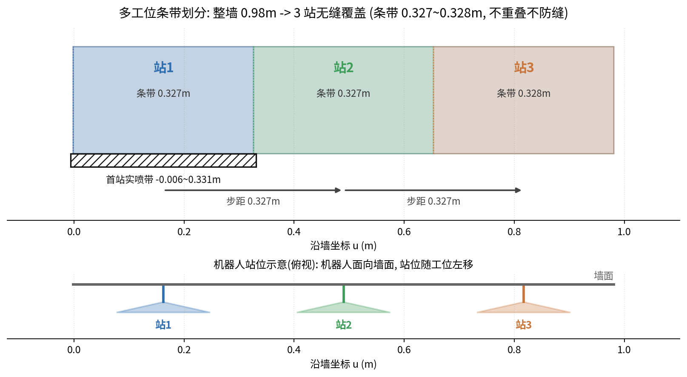
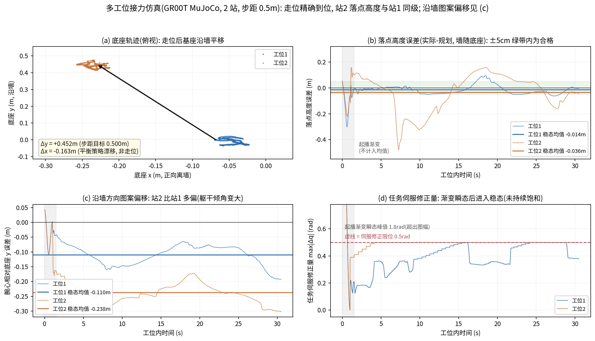

<div align="center">

# Scan · Plan · Spray

**从点云到真机喷涂：机械臂与人形机器人的壁面作业全栈实验**


**简体中文** | [English](README.en.md)

</div>


## 这是什么

同一个任务——**让机器人在壁面上自动走线 / 喷涂**——的两条完整技术线：

- **人形机器人线（宇树 G1）**：舱室点云配准 → 喷涂工位与站位点规划 → **站+蹲双姿态**等宽之字形轨迹 + 逐点 IK → 网页工作站 → 全身控制执行（策略基于 NVIDIA **GEAR-SONIC**），MuJoCo 仿真与物理 G1 实机一键切换（全带喷涂已实机验证）；
- **机械臂线（基于 OpenArm v1 的七轴臂）**：零点标定 → 仿真 → 真机，MPC / 强化学习 / ILC 三层推进，把一次 36 路点走线从 约 300 s 压到 **143.6 s**，全程零急停。

四个模块相互独立、均可单独运行；其中 `g1-wall-spray` 的点云输入就是 `pointcloud-registration` 的输出，工作区计算方法承自 `station-planning`。

本仓库是以上工作的归档记录：每个模块都留下可运行的代码、实测数据与设计文档。

## 模块导航

| 模块 | 干什么 | 入口 |
|---|---|---|
| [pointcloud-registration](pointcloud-registration/) | 黑白机器人扫描点云 ↔ 语义参考地图的**配准 + 语义标签传播**，纯 numpy 手写 | `python register_and_label.py` |
| [station-planning](station-planning/) | 喷涂**工位区域划分（BCD）与站位点规划**，可达域蒙特卡洛 | `station_planning.m`（MATLAB） |
| [g1-wall-spray](g1-wall-spray/) | G1 壁面喷涂**网页工作站 + 全身控制**（策略基于 GEAR-SONIC；站+蹲双姿态，实机全带已验证） | `./启动工作站.sh` → `127.0.0.1:8090` |
| [openarm-zigzag](openarm-zigzag/) | OpenArm 七轴**标定 → 仿真 → 真机**全链路，MPC/RL/ILC | 见模块 [README](openarm-zigzag/README.md) |

## 成绩单

| 模块 | 指标 | 数值 |
|---|---|---|
| pointcloud-registration | 配准精度（对齐 RMSE，全量数据） | **≈ 0.34 mm** |
| | 实现依赖 | numpy + matplotlib，无 PCL/Open3D |
| station-planning | 10 m × 2 m 示范墙 | 4 个 BCD 区域 → **12 个站位点**，覆盖连续无空缺 |
| | 单工位有效覆盖（腰扭 ±30°） | 宽 ≈1.1 m，可达区 1.12 m² / 喷涂覆盖区 2.53 m² |
| g1-wall-spray | 双姿态轨迹逐点 IK | **457/457 收敛**，枪-墙夹角实测 60–90° |
| | NN-IK 全域模型种子收敛率（iters=60） | **64%** vs 随机 MC 23.8%（换腰限/蹲姿地板免重训） |
| | V4.1 轻蹲+弯腰定稿（仿真全链验收 15/15，2026-10-13） | 全带 0.35–1.45m 而骨盆最深仅 约 0.55m，蹲姿参考严格限 [0.55,0.70] |
| | 实机全带喷涂（2026-10-12 深蹲版，×1.0 全程 155.6s） | 站+蹲 0.35–1.45m，站立段零模式翻转（V4.1 待实机 0.5× 首跑） |
| | 基座扰动补偿（世界系腕心误差） | 32 mm → **4 mm** |
| | 规划全链耗时（03 → 打包 → 终验） | ≈ 33 s |
| openarm-zigzag | 全程走线时长（MPC 基线 → RL+ILC） | 约 300 s → **143.6 s**，零急停 |
| | 跟踪精度 / 双跑重复性 | mean 1.19° / RMS **0.04°** |
| | 低频摆动抑制（0.5–2 Hz） | 3.8° → 0.7°，积分器峰值降 2–5× |

## 仓库结构

```
scan-plan-spray/
├── pointcloud-registration/   # 点云特征匹配配准 + 语义传播（纯 numpy）
│   ├── register_and_label.py  #   主算法（806 行，文件头含完整算法说明）
│   ├── make_sample_data.py    #   降采样样例生成（样例数据已附，开箱可跑）
│   ├── 舱室点云/                #   样例输入 ply + 真值变换
│   ├── docs/                  #   算法设计方案（docx）
│   └── figures/               #   输入 / 输出可视化
├── station-planning/          # 喷涂工位规划（BCD + 站位点）
│   ├── station_planning.m     #   MATLAB 主入口：10×2 m 示例全流程
│   ├── workspace/             #   Python 可达域计算（天工3.0 FK 蒙特卡洛）
│   ├── docs/                  #   设计方案 V2.0（PDF）+ 原方案（MD）
│   └── figures/
├── g1-wall-spray/             # G1 壁面喷涂工作站（网页 + 全身控制）
│   ├── scripts/               #   00–13 编号流水线 + exec/（守护/推流/急停）
│   ├── station/               #   配置、NN-IK 模型、three.js 前端静态件
│   ├── media/                 #   结果图 + MuJoCo 回放视频
│   ├── README.md              #   模块详解（含仿真/实机切换）
│   └── README_仿真版与实机版区别.md
├── openarm-zigzag/            # OpenArm 七轴机械臂实验平台
│   ├── 标定/ 仿真/ real/ ilc_sim/
│   ├── docs/                  #   9 篇技术文档（架构/PD 整定/RL/MPC/ILC）
│   ├── assets/figures/        #   9 张可溯源图件
│   └── README.md / README.en.md
└── assets/                    # 本 README 的总览图及其生成脚本
```

## 快速开始

**pointcloud-registration**（只需 numpy + matplotlib，样例数据已附带）

```bash
cd pointcloud-registration
python register_and_label.py     # 粗配准 → 自适应 ICP → 语义传播 → 输出 ply + 四视图 png
```

全量数据（500 万点）体积过大未入库；`make_sample_data.py --src <原始工程路径>` 可从原始数据重新生成降采样样例。

**station-planning**

```matlab
% MATLAB 中直接运行：10×2 m 墙 BCD 划分 + 12 站位点 + 可视化
run('station_planning.m')
```

可达域计算亦有纯 Python 版：`workspace/ws_calc.py`（天工3.0 右臂 FK 蒙特卡洛 + alpha-shape 边界）。

**g1-wall-spray**（需先在**本仓库同级目录**克隆 [GR00T-WholeBodyControl](https://github.com/NVlabs/GR00T-WholeBodyControl) 并配好 conda 环境，详见模块 README）

```bash
cd g1-wall-spray
cp station/env.json station/env.local.json   # 填本机解释器/GR00T 路径与 robot_mode(不入库)
./启动工作站.sh          # 打开 http://127.0.0.1:8090
# 网页流程：① 启动机器人（急停测试）→ ② 选点云/站位/姿态生成轨迹 → ③ 确认生成动作 → ④ 执行(可 0.5×)
# 仿真/实机切换：station/env.local.json 的 robot_mode（"sim" / "real"）
```

**openarm-zigzag**（Ubuntu 24.04 + ROS 2 Jazzy；标定工具支持 vcan0 无硬件全流程）

```bash
cd openarm-zigzag
cat README.md            # 按「快速上手」五步：标定 → MoveIt2 仿真 → MPC 真机 → RL → ILC
```

## 模块速览

### pointcloud-registration — 手写的点云配准，不调库

面对"机器人黑白扫描 ↔ 手持语义地图"这对点云，不用 PCL/Open3D，从 k-d 树到 ICP 全部 numpy 手写。粗配准不用通用特征盲配，而是利用舱室是长方体这一先验：**四个墙角 + 偏置门框做结构地标**，三元组距离几何一致性匹配 + Kabsch 求候选，稠密重叠度择优消除对称歧义；精配准是**自适应阈值点到面 ICP**（ε = μ + 0.1σ 剔误配 + 李代数增量 + 双收敛判据）；最后体素哈希最近邻把语义标签传播到机器人点云。

<table>
<tr><td width="50%"></td>
<td width="50%"></td></tr>
<tr><td align="center">输入：机器人黑白扫描（局部坐标系）</td>
<td align="center">输出：配准回参考系 + 语义标签传播</td></tr>
</table>

### station-planning — 工位与站位点：先算"机器人够得着哪"，再切墙

基于天工3.0 URDF 做蒙特卡洛 FK 求腕部可达域（alpha-shape 提边界），锥形喷幅取并集得单工位覆盖；墙面按障碍物投影做 **BCD 牛耕分解**，地面障碍上方墙面归入左区、控制台上方单独成区；每区按覆盖宽度分子区域、偏右设站位点，墙角 40 cm 单独设角落站，12 个站位点覆盖 10 m 整墙无空缺。方案成文于 [docs/](station-planning/docs/)（V2.0，15 页）。


### g1-wall-spray — 网页工作站 + 基于 SONIC 的全身控制

单文件 Python 网页工作站（标准库 HTTP 服务 + 内嵌 three.js 3D 预览）串起点云解析、轨迹规划、动作导出、执行下发。**全身控制策略基于 NVIDIA GEAR-SONIC**（GR00T-WholeBodyControl 官方栈）：下肢平衡由 SONIC 策略承担，上肢以 17 关节 @50 Hz + 速度前馈经官方 `zmq_planner_sender` 协议注入。MuJoCo 仿真与实机 DDS 共享同一条规划链，切换只改 `env.local.json` 一个字段。

**当前状态（V3 定稿，2026-10-12 实机全带喷涂验证）**：站姿 8 行 0.75–1.45 m → 五段过渡缓慢下蹲（最大降速 0.13 m/s，蹲姿通道分段门控保证站立段零模式翻转）→ 蹲姿 4 行 0.35–0.65 m，物理 G1 上 ×1.0 全程 155.6 s；两级软急停 + 0.5× 低速复核通道。蹲姿段落点精度（缺骨盆俯仰反馈）为当前主要短板。按日期的能力演进见 [g1-wall-spray/README_版本迭代.md](g1-wall-spray/README_版本迭代.md)。

<p align="center">
<br/>
<i>双姿态喷涂场景（蓝=站姿带 8 行，绿=蹲姿带 4 行，灰=过渡）</i>
</p>

<p align="center">
<br/>
<i>MuJoCo 回放总览（左=侧视 / 右=正视，12 个时刻：站姿喷上部 → 下蹲过渡 → 蹲姿喷下部）</i>
</p>

回放视频（与实机执行同款动作，×1.0 全程 155.6 s）：

<video src="g1-wall-spray/media/replay_motion.mp4" controls muted width="60%"></video>

**多工位接力（2026-10-20 仿真验收）**：整墙按动作带宽切成 N 条带，每站喷自己那条，
站间走一步再喷下一站；GR00T MuJoCo 两站接力实测走位 0.500/0.500 m 精确到位、
不摔倒，站 2 的落点高度误差与站 1 同级（稳态均值 -0.036 m vs -0.014 m），
沿墙方向的图案偏移约 12 cm（躯干倾角在走位后变大）。

<p align="center">
<br/>
<i>多工位条带划分：整墙 0.98 m → 3 站无缝覆盖（条带 0.327 m，步距 0.327 m）</i>
</p>

<p align="center">
<br/>
<i>两站接力仿真：底座轨迹 / 落点高度误差 / 沿墙图案偏移 / 任务伺服修正量</i>
</p>

### openarm-zigzag — 把"快"和"稳"同时做出来

OpenArm v1 七轴（达妙 DM 电机 + CAN-FD）上的全链路工程：纯 Python 复刻官方标定流程、四条仿真路线（MoveIt2 / 自研数值 IK / MuJoCo / Isaac Lab）、三条真机执行路线（JTC 基线 / ros2_control MPC 插件 / RL 策略 + ILC 前馈层）。9 篇技术文档记录了每一步的取舍：PD 整定的论文经验公式落地、RL 奖励与时间设计、73.4 s 急停的 0.5–2 Hz 猎振根因分析、ILC 从可行性论证到真机验收。


## 上游与致谢

- [enactic/openarm](https://github.com/enactic/openarm) — OpenArm v1 硬件与官方 ROS 2 工作区，本仓 `openarm-zigzag` 在其上构建
- [NVlabs/GR00T-WholeBodyControl](https://github.com/NVlabs/GR00T-WholeBodyControl) — `g1-wall-spray` 全身控制策略（GEAR-SONIC）的来源；上肢注入沿用其官方 `zmq_planner_sender` 协议
- 宇树 Unitree G1 官方 URDF / SDK2；达妙 DM 电机系列
- 之字形（boustrophedon）走线方式参考了开源项目 spray-coating-robot 的实现
- PD 整定经验公式来自 arXiv:2508.08241

## 许可

[MIT](LICENSE)。仓库含直接驱动真实机器人的代码，不附带任何安全担保；上真机前请自行完成安全评估与急停演练。

