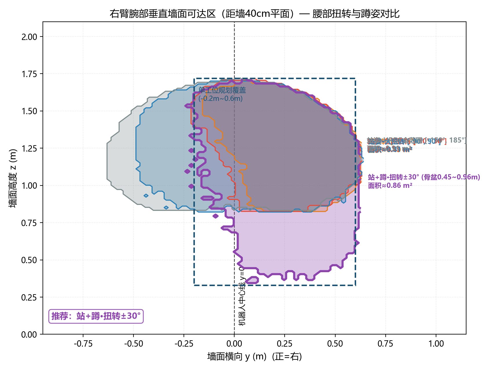

# 喷涂工位规划：可达域蒙特卡洛 + BCD 区域划分 + 站位点

喷涂工艺轨迹规划的**前置模块**：输入舱室三维语义地图提取的待喷涂墙面
（投影为 y-横向 / z-高度二维平面），输出**三维站位点集合**（坐标、朝向、
类型），保证机器人完整覆盖目标区域、站位之间无碰撞、喷涂无空缺。

对应方法论文档见 [docs/喷涂工位规划算法设计方案V2.0.pdf](docs/喷涂工位规划算法设计方案V2.0.pdf)（15 页），
文字版 [docs/原方案.md](docs/原方案.md)。

## 方法

1. **机器人工作区间**（`workspace/ws_calc.py`、`tiangong_workspace.m`）
   基于"天工3.0"人形机器人 URDF 运动学，对喷涂臂关节做蒙特卡洛采样、
   批量正向运动学得到腕部（喷枪安装位）在距墙平面上的可达点云，
   alpha-shape 提取可达区边界。四档腰部扭转范围对比后取 **±30°**：
   腕部可达区 1.12 m²，锥形喷幅（60°@0.40 m）喷涂覆盖区 2.53 m²，
   单工位有效覆盖取外包络矩形 **宽 ≈1.1 m**。
2. **墙面区域划分——牛耕分解（BCD）**（`station_planning.m`）
   障碍物投影到墙面，其边界生成切割线：地面栅栏上方墙面归入左侧大区域、
   控制台（0~1 m 高）上方单独成区、贴角加强筋合并处理。
3. **站位点规划**
   每个区域按覆盖宽 W_cov 分子区域；覆盖非对称（向右 0.8 m / 向左 0.3 m），
   站位点偏右设置使覆盖左边界对齐子区左界；墙角 40 cm 单独设角落站位；
   站位点距栅栏等物理障碍 ≥30 cm，加强筋距墙角 <30 cm 时并入相邻角落站位。

## 示例结果（10 m × 2 m 墙）

| 项目 | 结果 |
|---|---|
| BCD 区域 | 4 个（含栅栏上方合并区 ×2、控制台上方区 ×1） |
| 站位点总数 | **12 个**（9 普通 + 2 角落 + 1 控制台） |
| 覆盖连续性 | y=0~10 m 全覆盖、无喷涂空缺 |

<table>
<tr><td width="50%"></td>
<td width="50%"></td></tr>
<tr><td align="center">BCD 区域划分与切割线</td>
<td align="center">三维站位点分布（12 个）</td></tr>
</table>



## 运行

```matlab
% MATLAB：10×2 m 示例全流程（参数在文件头集中定义）
run('station_planning.m')
```

```bash
# 纯 Python 可达域计算（numpy，关节链参数内嵌自 URDF）
python workspace/ws_calc.py
```

`workspace/` 下另有一组方案迭代期的工作脚本（蹲姿工作区 `ws_squat.py`、
方案图生成 `fig_*.py`、区域自检 `check_*.py` 等），保留作过程记录。

## 文件

| 文件 | 说明 |
|---|---|
| `station_planning.m` | MATLAB 主入口：BCD 划分 + 站位点 + 可视化 |
| `tiangong_workspace.m` | 天工3.0 可达域 MATLAB 版 |
| `station_data.mat` / `tiangong_ws_data.mat` | 站位点与可达域数据 |
| `workspace/` | Python 工作区计算与方案图脚本 |
| `docs/` | 设计方案 V2.0（PDF）+ 原方案（MD） |
| `figures/` | 方案图（架构 / BCD / 场景 / 俯视 / 工作区对比 / 覆盖） |

## 与其他模块的关系

本模块回答"机器人**站在哪、够得着哪**"；`../g1-wall-spray/` 的
`02_g1_workspace.py` 把同一套可达域方法移植到 G1（距墙三平面取交集，
消化定位误差），`03_plan_trajectories.py` 再在其上生成之字形轨迹。
