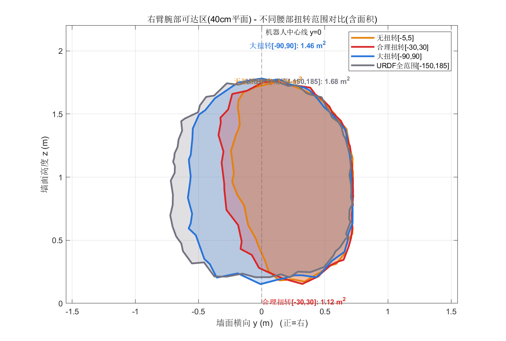
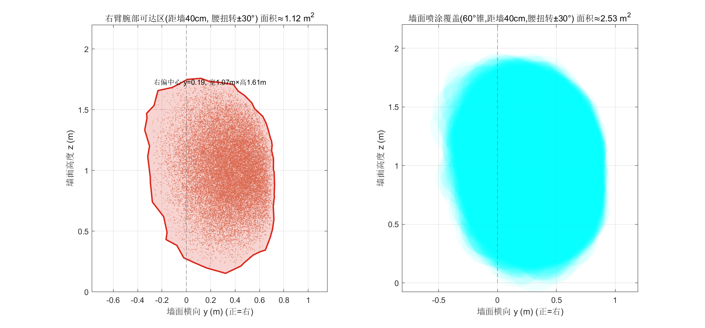
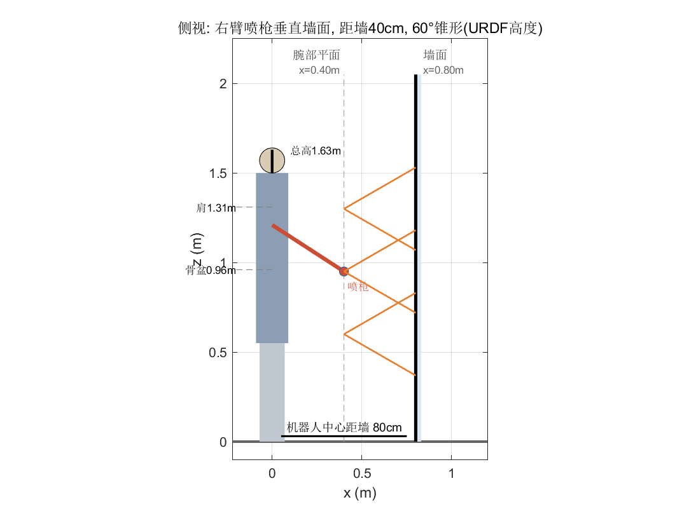
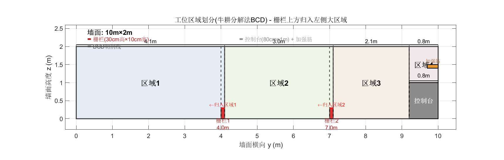
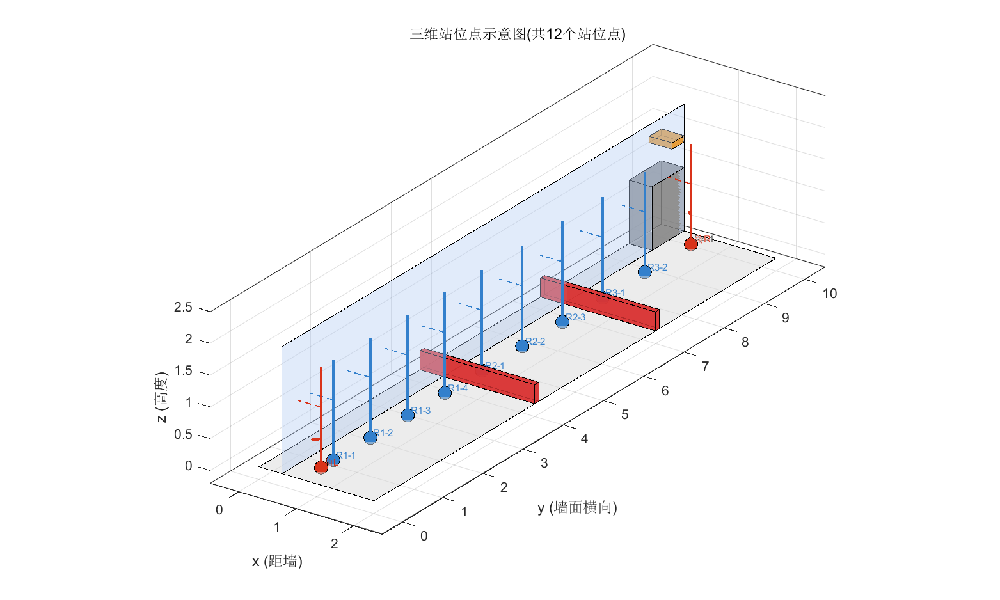
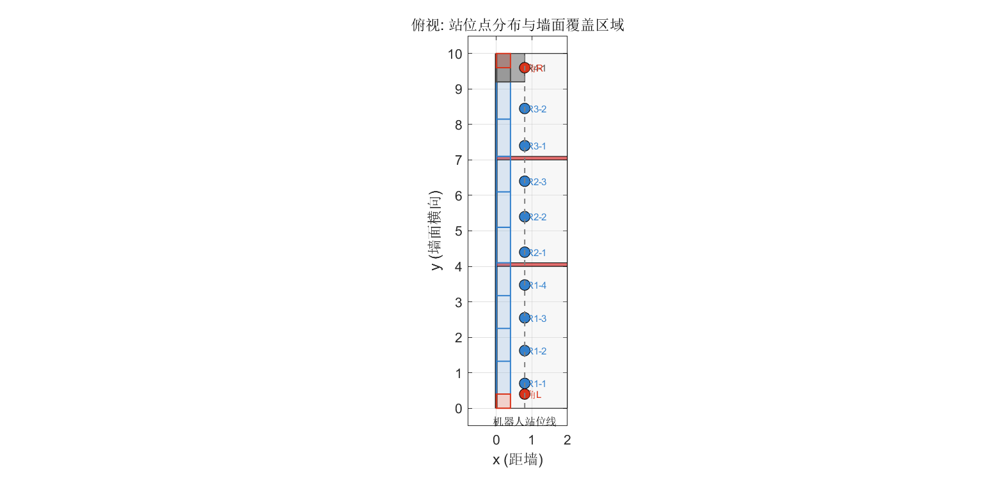

喷涂工位规划算法设计方案

杨湘传 2026年08月

一、概述

喷涂工位规划算法是喷涂工艺轨迹规划的前置模块。该模块基于前置模块输出的舱室三维语义地图，提取待喷涂墙面并将其投影为二维平面（y为横向，z为高度），综合考虑机器人作业空间约束、障碍物分布及喷涂工艺参数，规划合理的喷涂工位（站位点），使机器人能够完整覆盖目标喷涂区域，输出三维站位点集合（含坐标、朝向、类型），为后续路径规划与喷涂轨迹规划提供输入。

**喷涂工艺参数：**喷枪扇形角θ，腕部距墙d_g，机器人中心距墙d_r，作业高度范围H（以上参数待替换为实际设备参数，示例中取θ=60°，d_g=0.40m，d_r=0.80m，H=0\~2m）。

二、机器人工作区间分析方法

2.1 基于URDF的工作空间分析

基于人形机器人URDF运动学模型，采用蒙特卡洛采样法对喷涂臂（如右臂）各关节在运动范围内进行随机采样，通过正向运动学计算腕部（喷枪安装位置）在距墙d_g平面上的可达点云，再通过边界提取算法（如alpha-shape）得到可达区域边界。单工位有效覆盖范围由可达区域包络矩形确定，作为后续区域划分的基本单元。

2.2 喷涂覆盖区计算

腕部安装喷枪，扇形角为θ。喷枪距墙d_g时，在墙面上形成的扇形喷涂半径为：R
= d_g ×
tan(θ/2)。将腕部可达区内每个采样点对应的墙面扇形覆盖区域取并集，即得到单工位喷涂覆盖区。覆盖区面积A_cov
= f(θ, d_g, 可达区尺寸)，工程上取其外包络矩形（宽W_cov ×
高H_cov）作为单工位有效覆盖范围。

2.3 腰部扭转范围选择

腰部偏航（Waist
Yaw）扭转范围直接影响喷涂臂在墙面上的可达宽度。范围过小则覆盖宽度不足、站位点过多；范围过大则超出实际喷涂姿态需求且增加运动时间。通过对比分析不同扭转范围（如±5°、±30°、±90°、URDF全范围）下的可达区面积与覆盖宽度，选择面向墙面喷涂的合理工作范围，通常取±30°左右。

三、基于牛耕法（BCD）的墙面区域划分方法

3.1 算法原理

牛耕分解法（Boustrophedon Cellular Decomposition,
BCD）基于障碍物边界将空间划分为互不重叠的凸区域。应用于墙面喷涂场景时，将三维语义地图中的墙面投影为二维平面（y为横向，z为高度），障碍物在墙面上的投影视为不可喷涂区域，其边界线作为切割线将墙面划分为若干可喷涂的矩形区域。切割线位置由障碍物在y轴上的边界坐标确定。

3.2 障碍物分类与处理策略

**地面障碍物（如栅栏）：**仅占据地面以上较低高度（如30cm），其上方墙面仍需喷涂。处理方法：以障碍物右边界为切割线，将障碍物上方区域归入左侧大区域，简化区域划分。同时，障碍物作为物理障碍，机器人站位需预留安全距离（≥30cm），在后续工作点规划中予以考虑。

**立面障碍物（如控制台）：**占据一定高度范围（如0\~1m），其上方墙面（如1\~2m）单独划分为一个区域。

**特征物（如加强筋）：**小尺寸凸起物，需特殊喷涂处理。若距墙角过近，可合并至相邻角落站位，避免机器人碰撞墙壁。

3.3 区域划分流程

**步骤1：**获取障碍物在墙面投影的边界坐标，按y坐标排序生成切割线集合。

**步骤2：**沿切割线将墙面纵向划分为若干矩形区域，每个区域z范围默认H（全高度），特殊区域（如控制台上方）z范围取障碍物上方剩余高度。

**步骤3：**对地面障碍物，将其上方归入左侧区域，使每个区域为连续矩形，便于后续子区域划分。

**步骤4：**输出区域列表，每个区域包含：y范围、z范围、尺寸、类型（普通/特殊）。

四、工作点（站位点）规划方法

4.1 子区域划分

将每个BCD大区域的y范围按单工位覆盖宽度W_cov划分为若干等宽子区域，使每个子区域宽度不超过W_cov。覆盖范围完整覆盖整个区域（含地面障碍物上方的墙面，确保无喷涂空缺）；障碍物安全距离仅约束站位点位置，不影响覆盖。

**步骤1
确定覆盖范围：**每个区域的覆盖y范围取该区域的完整y范围（扣除角落站位负责的wrap范围），确保连续覆盖无空缺。

**步骤2 计算列数：**N_col = ceil(覆盖宽度 / W_cov)，每列宽度 = 覆盖宽度
/ N_col。由于覆盖非对称（向右0.8m，向左0.3m），设子区域为\[y0,
y1\]，站位点应设置在y = y0 + 0.3处，使得覆盖范围\[y-0.3, y+0.8\] = \[y0,
y0+1.1\]完整覆盖子区域左边界。

**步骤3
设置站位点：**每列中心横向处设置站位点，机器人站位于距墙d_r处（x=d_r），地面高度z=0。

**步骤4
避障校验：**检查站位点距物理障碍物（栅栏）边缘是否≥30cm；若不足，将站位点向远离障碍物方向偏移，并确保覆盖连贯。

4.2 站位点类型与设置策略

**普通站位点：**按上述子区域划分方法，在各子区域中心设置，机器人正对墙面，覆盖该子区域全高。

**角落站位点：**墙面两端各单独设置一个，距墙端约40cm，朝向墙角方向，确保墙角区域喷涂充分。角落站位只负责墙角本身（0\~40cm），其余墙面由相邻普通站位覆盖。

**特殊位置：**加强筋等小尺寸特征物，若距墙角或其他站位点较近，优先合并至相邻站位，避免独立站位导致机器人碰撞墙壁。

4.3 安全距离与碰撞约束

站位点距物理障碍物（栅栏）边缘至少30cm；距墙壁两侧需预留足够空间，避免机器人躯干或手臂碰撞。特征物距墙角过近时（如\<30cm），其喷涂任务合并至相邻角落站位。

五、示例：10m×2m舱室墙面喷涂工位规划

5.1 场景参数

以一块宽10m、高2m的典型舱室墙面为例（由三维语义地图投影得到），具体参数：

  -----------------------------------------------------------------------
  **参数**            **数值**                   **说明**
  ------------------- -------------------------- ------------------------

  -----------------------------------------------------------------------

  -----------------------------------------------------------------------
       墙面尺寸              宽10m × 高2m           由三维语义地图投影
  ------------------- -------------------------- ------------------------
      喷枪扇形角                 60°                  待替换为实际值

       腕部距墙                 0.40 m                待替换为实际值

    机器人中心距墙              0.80 m                待替换为实际值

         栅栏1          y=4.0m, 宽10cm×高30cm       贯穿房间，地面障碍

         栅栏2          y=7.0m, 宽10cm×高30cm       贯穿房间，地面障碍

        控制台        y=9.2\~10.0m, 宽80cm×高1m          右侧设备

        加强筋          y=9.7\~10.0m, z=1.4m,      贴着墙角，控制台上方
                            厚10cm×宽30cm        
  -----------------------------------------------------------------------

5.2 工作区间分析结果

基于天工3.0人形机器人URDF，对四种腰部扭转范围各采样80万点。选择腰部扭转±30°作为合理工作范围：腕部可达区面积约1.12
m²（y: -0.34 \~0.72m, z: 0.15\~1.76m），喷涂覆盖区面积约2.53
m²（60°锥形，距墙40cm）。要求喷涂竖直范围为0\~2m，无法垂直喷涂的范围考虑倾斜喷涂，需要保证角度在〔角度约束公式见 PDF 版〕。此工程上取单工位有效覆盖为宽约1.1m，高约2m。

图1 右臂腕部可达区 - 不同腰部扭转范围对比

图2 右臂腕部可达区与喷涂覆盖区（腰扭转±30°，60°锥形）

图3 侧视：右臂喷枪垂直墙面，距墙40cm，60°锥形

5.3 BCD区域划分结果

切割线由障碍物边界确定：y=4.0, 4.1, 7.0, 7.1, 9.2
m。栅栏上方区域归入左侧大区域，控制台上方单独划分。共4个区域：

  --------------------------------------------------------------------------------
   **区域**     **y范围**      **z范围**       **尺寸**            **说明**
  ---------- --------------- -------------- --------------- ----------------------
    区域1     0.0 \~ 4.1 m    0.0 \~ 2.0 m    4.1m × 2.0m      含栅栏1上方区域

    区域2     4.1 \~ 7.1 m    0.0 \~ 2.0 m    3.0m × 2.0m      含栅栏2上方区域

    区域3     7.1 \~ 9.2 m    0.0 \~ 2.0 m    2.1m × 2.0m          无障碍物

    区域4     9.2 \~ 10.0 m   1.0 \~ 2.0 m    0.8m × 1.0m    控制台上方，含加强筋
  --------------------------------------------------------------------------------

图4 工位区域划分（牛耕分解法BCD）

5.4 工作点规划结果

按单工位覆盖宽度1.1m对各区域进行子区域划分。**覆盖范围完整覆盖整面墙（含栅栏上方墙面）**；栅栏作为物理障碍物贯穿整个房间深度，将机器人站位分隔为前后两个区域，仅约束站位点位置，即站位点中心距栅栏边缘≥30cm，但覆盖不受影响。由于机器人工作区域非对称（向左0.3m，向右0.8m，+y为右），站位点偏右设置。各区域子区域与站位点如下：

**区域1（覆盖y=0.40\~4.10，宽3.70m）：**4列，每列0.93m，站位点y=0.70,
1.62, 2.55,
3.47m（偏右设置）。第4列(R1-4)距栅栏1边缘58cm，覆盖栅栏1上方墙面(y=3.17\~4.10)。

**区域2（覆盖y=4.10\~7.10，宽3.00m）：**3列，每列1.00m，站位点y=4.40,
5.40,
6.40m。第1列(R2-1)距栅栏1边缘35cm，第3列(R2-3)距栅栏2边缘65cm，两端上方墙面均有覆盖。

**区域3（覆盖y=7.10\~9.20，宽2.10m）：**2列，每列1.05m，站位点y=7.40,
8.45m。第1列(R3-1)距栅栏2边缘35cm。

**区域4（覆盖y=9.20\~10.00，宽0.80m）：**1列，站位点y=9.60m，覆盖控制台上方墙面(z=1\~2m)。

**角L：**y=0.40m，只负责左墙角区域(y=0\~0.40m)，朝向墙角。

**角R（合并加强筋）：**y=9.60m，只负责右墙角区域(y=9.60\~10.0m)。加强筋距墙角仅25cm，单独设点机器人易碰撞墙壁，故合并至角R，由角R兼顾墙角与加强筋喷涂。

总计12个站位点（9普通 + 2角落 +
1控制台）。角落站位只负责墙角本身（0\~40cm）及合并的加强筋，其余墙面由对应区域普通站位覆盖，整面墙y=0\~10m覆盖连续、无喷涂空缺：

  --------------------------------------------------------------------------
   **编号**    **类型**    **y (m)**        **负责覆盖区域**       **x (m)**
  ---------- ------------ ----------- ---------------------------- ---------
     角L         角落        0.40          左墙角 y=0\~0.40m         0.80

     R1-1        普通        0.70            y=0.40\~1.32m           0.80

     R1-2        普通        1.62            y=1.32\~2.25m           0.80

     R1-3        普通        2.55            y=2.25\~3.17m           0.80

     R1-4        普通        3.47      y=3.17\~4.10m(含栅栏1上方)    0.80

     R2-1        普通        4.40            y=4.10\~5.10m           0.80

     R2-2        普通        5.40            y=5.10\~6.10m           0.80

     R2-3        普通        6.40      y=6.10\~7.10m(含栅栏2上方)    0.80

     R3-1        普通        7.40            y=7.10\~8.15m           0.80

     R3-2        普通        8.45            y=8.15\~9.20m           0.80

     R4-1       控制台       9.60         控制台上方 z=1\~2m,        0.80
                                             y=9.20\~10.0m         

     角R         角落        9.60     右墙角+加强筋 y=9.60\~10.0m    0.80
  --------------------------------------------------------------------------

图5 三维站位点示意图（共12个站位点）

图6 俯视：站位点分布与墙面覆盖区域
